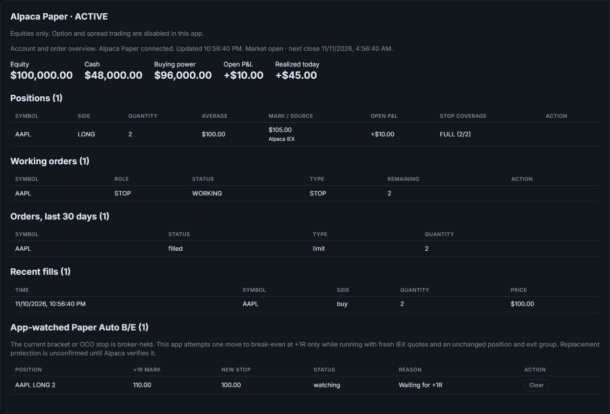
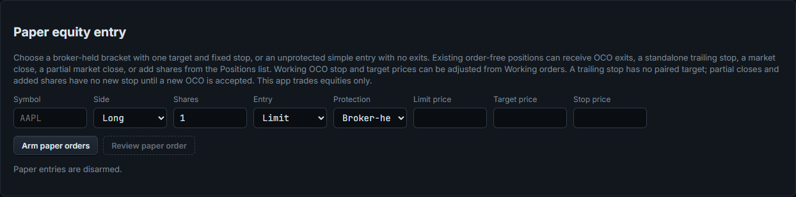

# Edge Trader for Schwab

A local equities trading dashboard for Alpaca Paper and Charles Schwab. Alpaca Paper is selected by
default; Schwab and Demo are selectable in the app. It shows your open positions with live R, open and realized P&L and every working
order, and lets you enter a fully protected bracket (entry, stop and target, sized from the dollars you
want to risk) and manage it with one click: stop to break-even, move the stop, trail it, replace the
target, take partials, cancel or close. It runs on your own computer, next to thinkorswim or your charts.

**Alpaca Paper preview:** New installations select Alpaca Paper by default. Its account overview shows
balances, positions, recent and working orders, recent fills, market hours, stop coverage, and P&L
coverage from paper fills and IEX/indicative quotes. Stale or incomplete data is labeled. The Paper
equity form accepts a flat symbol with no active order and a whole-share long or short market/limit
entry. Choose a broker-held bracket with one target and fixed stop, or explicitly choose an unprotected
simple entry with no attached exits. Arm entries for the market day, review the protection choice, then
confirm the Paper order. Bracket target and stop are broker-held after the entry fills. An unfilled app-created Paper
entry can be canceled, or its limit price replaced, from the working-order list after a fresh broker
check. A replacement keeps the same stop and target and remains blocked until Alpaca confirms the
new order ID and reviewed price; a simple entry remains unprotected. A held whole-share equity position with no active order can receive
one broker-held OCO target and fixed stop after a fresh position, order, and IEX quote check. The same
OCO's working target can be moved, and its fixed stop can only be tightened, after a fresh broker
read and an exact-price replacement confirmation. Replacement outcomes block further order actions
until Alpaca confirms the new client order ID and price. The same manual controls apply to the working
target and stop of an app-created bracket after its entry has fully filled and the held share count
matches both exits. An external or partially filled bracket cannot be adjusted through this app. The same
app-created, unchanged OCO or filled bracket can opt into **Paper Auto B/E +1R** from its working stop row.
This is an app-watched move: after two distinct fresh IEX quotes at +1R, the app checks the
held position and both OCO exits again, then attempts one tighter fixed-stop replacement at
the held entry basis. The original stop is broker-held before the move; protection is unconfirmed
while Alpaca processes the replacement.
Auto B/E pauses if the app is off, the market is closed, or quotes are stale. A changed position
or protected exit group ends the watch and requires a new review. An uncertain replacement blocks further broker
actions until reconciled; the app never retries it automatically.
The same
order-free position can instead be closed fully or partially with one market order from the Positions
list after arming and reviewing the share count and indicative IEX mark. The actual fill price can differ.
Any shares left after a partial close have no new stop; attach an OCO after the fill is confirmed. A
position with a working exit must have that order resolved first; closing does not cancel its OCO.
An order-free position can also add whole shares with a confirmed market order. Added shares are
unprotected until the fill is confirmed and an OCO for the new total position is accepted.
An order-free whole-share equity position can instead attach one standalone broker-held trailing
stop by dollar or percent distance. It has no paired target, does not trigger outside regular market
hours, and a triggered stop becomes a market order whose fill may differ from the stop price.
**Trading scope:** This app supports equities only in Alpaca Paper and Schwab. Option and spread trading controls, API routes, and automatic spread-stop sending are disabled for both brokers. Existing option positions and orders may still appear in read-only account views; manage them directly with the broker.

A lost submit or cancel response also blocks new order actions until the broker confirms its outcome. Select Schwab in the app for its equity trading workflows. Switching disarms
entries and loads a fresh broker runtime before order controls can be used again.
The strip below the header explains which workflows the selected broker can currently use; Demo
shows invented data with order controls disabled.

These Paper screenshots use invented account data and intercepted browser responses.

- **Your data stays on your computer.** No account with us, no cloud, no telemetry. The app talks to the selected broker.
- **Every order is your click.** No signals, no auto-trading. The optional Auto B/E watch can move an equity stop to break-even once at +1R.
- **Protection first for Schwab trades.** Entries go in as one Schwab bracket, so the stop and target live at Schwab even if the app or your PC is off. Leaving out the stop is possible only when you size by quantity, and the ticket asks you to confirm it every time.
- **Honest numbers.** P&L comes from your own fills, and anything incomplete is labeled as such, never shown as complete.
- **Free and MIT licensed.** No paid tier.

**[Quick start](#quick-start)** · **[Your Schwab app](#your-schwab-app)** · **[Releases](https://github.com/neusse/edge-trader-for-schwab/releases)** · **[Privacy](#privacy-and-your-data)**

**What this is not:** not financial advice, not a signal service, not affiliated with or endorsed by
Charles Schwab. Every screenshot below is invented demo data, not anyone's real account.

**[Watch the walkthrough first](https://youtu.be/41VQNmCN2r4)** on the Tape to Edge YouTube channel: a full tour on a live account, from sizing the shares from your risk and sending the bracket to partials that rebuild your stop and target, then the setup and the limits.

## Quick start

On Windows, install Python 3.11 or newer, then run `setup.bat` from this repository. It creates
`.venv`, installs the packages, and copies `.env.example` to `.env` if that file does not exist.
Enter your **Alpaca Paper** key and secret as `alpaca_paper_api_key` and `alpaca_paper_secret` in
`.env`, or provide them in the process environment. Keep `.env` private. Live Alpaca credentials
and endpoints are not accepted.

Run `launch.bat` and open [http://127.0.0.1:8770](http://127.0.0.1:8770). Alpaca Paper is the
default; the broker selector also offers Schwab and Demo. Review the selected account, positions,
and working orders before arming equity orders. `stop.bat` stops the local server; broker-held orders
remain with the broker. Demo uses invented data and cannot send orders.

## Your Schwab app

To select Schwab, use your Schwab developer app's key and secret in `SCHWAB_APP_KEY` and
`SCHWAB_APP_SECRET`. Set `SCHWAB_CALLBACK_URL` to the exact callback URL registered for that app;
the default is `https://127.0.0.1`. Run `login.bat` to complete Schwab's browser sign-in, then
select Schwab in Edge Trader. The token file defaults to `~/.schwabdev/tokens.db`; use
`SCHWAB_TOKENS_DB` to choose another location or `SCHWAB_ENV_FILE` to read keys from an existing
local `.env`. Schwab trading in this app is equities only.

## Built on Schwabdev

Edge Trader connects to Schwab through **[Schwabdev](https://github.com/tylerebowers/Schwabdev)** by
**Tyler Bowers** (MIT licence), the Python client for the Schwab Trader API. Schwabdev handles the
Schwab sign-in (OAuth), the token refresh and the API calls. Thank you, Tyler. If Edge Trader is useful
to you, consider starring Schwabdev too.

## Privacy and your data

Edge Trader runs on your own computer and listens on `127.0.0.1` only (requests with any other host
name are refused). It needs no account and sends no telemetry.

### What stays local

- Your broker credentials in `.env` and Schwab tokens (`~/.schwabdev/tokens.db`, managed by Schwabdev).
- Everything the app records: positions, orders, fills, the action log and settings, in account-scoped SQLite databases under `data/`. The existing Schwab database remains `data/companion.db`.

### What leaves your computer

- **Schwab** (`api.schwabapi.com`): the Trader API calls that read your account and send the equity orders you click. When Alpaca Paper is selected, a separate read-only quotes client prices any visible option holdings or working option orders through Schwab; it cannot send orders.
- **Alpaca Paper** (`paper-api.alpaca.markets`): paper account and order reads plus the equity actions described above. The app sends an order only after its review and confirmation. No live Alpaca order endpoint is configured.
- **Alpaca market data** (`data.alpaca.markets`): stock IEX quotes for equity workflows. The hidden, read-only option-chain discovery API can still return Alpaca indicative data; visible Paper option holdings and working orders use Schwab quotes. Option trading and automatic spread stops are disabled.
- **GitHub** (`api.github.com`), once a day: a check for a newer Edge Trader release. It only shows a
  notice; it never downloads or installs anything. Turn it off with `EDGE_TRADER_NO_UPDATE_CHECK=1` in `.env`.
- **Google Fonts**: the page loads the Inter and JetBrains Mono fonts. Offline it falls back to system fonts.

### API keys

Keys live in `.env` or your process environment on your machine, which is never committed. Do not share or commit `.env`, the
`data` folder, the tokens file, or screenshots of your real account.

## What's inside

- **Dashboard:** open positions (day trades and carried positions apart) with open P&L, live R, stop
  and target, protection (FULL, PARTIAL, NO STOP SEEN) and P&L at the stop; working orders including
  brackets and GTC orders; closed trades and realized P&L from your fills; a health light (LIVE,
  STALE, DISCONNECTED) that disables every order button when data is not current.
- **New trade:** symbol, side, stop, risk in dollars (four buttons you set yourself), entry at the mid,
  market, ask, bid or your own limit price (Lmt), one or two targets by R or by price, and a fixed stop, a trailing stop, or "Auto
  B/E 1R": a fixed stop that the app moves to break-even once when the mark reaches +1R of your fill
  (it checks every 3 seconds and only while the app is running; it never loosens a stop). One click
  sends one Schwab bracket. Entries must be armed each session.
- **Size by risk or by quantity:** size from your risk and stop (the default), or type the number of
  shares yourself. Sizing by quantity also allows **no stop** (a red warning and a
  confirmation on every click) and either way you can send **no target**. The order then carries only
  what you picked; add the missing stop or target later from the trade (Set stop / Set target), and
  once it has both they are paired as one OCO.
- **Cockpit layout (new in 1.4.0):** the page's layout from 1.4.0 on (it replaces the old Classic
  layout). The selected trade gets a price ladder at true price spacing: last price, entry, stop,
  target and 1R levels, with your exits as cards beside it. Drag a stop or target line to a new price: the drag only
  fills the price box, and nothing is sent until you click the button. An attention bar lists what needs you: no stop, a stop that covers only part of the position, or an order with an unclear outcome.
- **Add shares (new in 1.4.0):** add to a stock position from its workbench at the mid, market, ask or
  bid. **Keep stop** leaves the stop where it is (more dollars at risk); **Keep risk** moves the stop so
  the dollars at risk stay the same. Then ONE stop and target go back on the whole new size, and 1R is
  recalculated from the new average entry.
- **Today's tickets:** every entry of the day in one list, marked by where it came from: the New trade
  ticket, an Add shares (ADD), thinkorswim (TOS) or anywhere else (OTHER), with its protection and P&L.
- **Workbench for the selected trade:** the price ladder (original stop, current stop, entry, 1R,
  targets, price), stop to break-even, move stop, Schwab-held trailing stop (R, dollars or percent), replace
  target, partials at the mid, market, ask or bid (the stop and target are rebuilt on the rest), cancel
  orders and close. On a trailing stop, a partial or a new target asks first: restart the trail from the
  current price, or keep the stop fixed at the level the trail reached.
- **Floating windows:** small always-on-top Entry and Manage windows to keep next to your charts.
- **Market clock** with the session countdown (Schwab's calendar, holidays and early closes) and an
  optional spoken alert 10 minutes before the close if day trades are still open. Orders follow the
  same hours: on a market holiday, or after an early close (like the day after Thanksgiving), every
  order is refused, and arming lapses at that session's close.
- **Safety rails:** no order is ever retried automatically; an order with an unclear outcome blocks
  further orders for that symbol until Schwab confirms it or you press Resolve; the app never opens
  Schwab's streamer, so it never disconnects another app that uses it.

## Screenshots

**The selected trade.** The price ladder shows where price sits between your original stop, the
current stop and the target; drag a line to set a price, and the button sends. Trail options open in
place, with where the trail would start and a warning when it would be looser than your stop.

**New trade.** Pick the risk, the entry price and the targets; the plan shows the exact orders and the
risk before you send.

## Configuration

| Variable | What it does |
|---|---|
| `alpaca_paper_api_key`, `alpaca_paper_secret` | Alpaca Paper credentials for the default broker. Live credentials are not accepted. |
| `alpaca_paper_endpoint` | Optional; only `https://paper-api.alpaca.markets` is accepted. |
| `SCHWAB_APP_KEY`, `SCHWAB_APP_SECRET` | Your Schwab app, when Schwab is selected. |
| `SCHWAB_CALLBACK_URL` | Must match your app's callback URL. Default `https://127.0.0.1`. |
| `SCHWAB_TOKENS_DB` | Where Schwabdev keeps the tokens. Default `~/.schwabdev/tokens.db`. |
| `SCHWAB_ENV_FILE` | Read the keys from another app's `.env`, to share one Schwab sign-in between apps. |
| `COMPANION_PORT` | The local port. Default `8770`. |
| `EDGE_TRADER_NO_UPDATE_CHECK` | `1` turns off the daily check for a newer release. |

## Good to know

- **Futures:** Schwab's API reports futures fills but not futures positions or orders, so Edge Trader
  shows futures realized P&L only and cannot trade futures.
- **Options and spreads:** trading controls are disabled for Alpaca Paper and Schwab. Existing Paper option holdings remain visible as read-only account data and use Schwab market quotes when its login is available. Missing Schwab option quotes leave those holdings unpriced without disabling Paper equity trading. Manage any existing option orders directly with the broker.
- **No stop at entry:** a trade sent without a stop gets its R from the first stop you set from the
  app once Schwab shows it working (a stop set in thinkorswim does not count).
- **One stream per Schwab user:** Edge Trader polls (REST) and never opens Schwab's streamer, so it
  works alongside thinkorswim and other tools. It keeps its own requests well under Schwab's limits.
- **Schwab cancels a symbol's working orders when a new order for it is entered.** Edge Trader is built
  around that: partials, target changes and trails send one new bracket for the remaining shares.
  It also means an **Add shares** order drops your stop and target while it fills: the position has no
  stop at Schwab until the add fills and the new stop goes on (usually about a second: a limit add rests
  at most 3 seconds, then the rest goes at market).
- **Planned risk is not maximum loss:** a stop becomes a market order when it triggers and can fill
  past its price on a gap or a halt.
- **Recording mode:** `.venv\Scripts\python.exe -m companion --private` hides positions carried from
  earlier sessions, their orders, the carried P&L and the account value, so you can record or share your
  screen while showing only today's trades. It only changes what is displayed; orders work as usual.
  `--demo` runs on invented data with no Schwab connection, and refuses every order (the ticket plans on
  invented quotes, so you can try the equity ticket).

## Troubleshooting

| Symptom | What to check |
| --- | --- |
| Alpaca Paper stays connecting or reports an authentication error | Check `alpaca_paper_api_key` and `alpaca_paper_secret` in your local `.env` or process environment, then restart the app. Use Paper credentials; live Alpaca credentials and endpoints are refused. Do not paste keys into an issue. |
| A Paper equity review button is disabled | Select Alpaca Paper, wait for fresh account and order data and regular market hours, arm Paper orders, and check that the symbol has no held position or active order. The entry form accepts whole shares and one target/stop bracket or an explicitly unprotected simple entry. |
| A Paper equity quote is stale or missing | Paper stock quotes use IEX. Wait for a fresh regular-hours quote and refresh the app; an order cannot be sent from stale or incomplete data. Check the symbol and market clock before trying again. |
| A submit, cancel, or replacement says its outcome is unknown | Check the order directly in Alpaca Paper before using the app's reconcile control. Do not send another order or reuse the request while its outcome is uncertain; the app does not retry automatically. |
| Broker selection changes or order controls remain disarmed | Check the active broker and account shown in the app. Switching brokers disarms orders; arm only after reviewing the new account, positions, and working orders. If the app requests a restart, restart before ordering. |
| An existing option position or order appears | It is read-only here. Option and spread trading are disabled for both brokers; manage existing option orders directly with the broker. |

## Contributing

Bug reports and pull requests are welcome. [CONTRIBUTING.md](CONTRIBUTING.md) covers setup, tests and
the safety rules every change must keep. Please report security problems privately, as described in
[SECURITY.md](SECURITY.md), not in a public issue.

## Who made this

A day trader who wanted one-click, defined-risk brackets and fast trade management on Schwab, next to
his charts. Built by describing the problems to Claude Code.

- YouTube: [@tapetoedge](https://www.youtube.com/@tapetoedge)
- X: [@tapetoedge](https://x.com/tapetoedge)

Educational software, not financial advice. Not affiliated with Charles Schwab. No affiliate
relationship with anything shown here. You are responsible for your own trading decisions and every
order you send, and the software comes with no warranty.

## License

MIT. See [LICENSE](LICENSE). Schwabdev is MIT licensed by Tyler Bowers.
